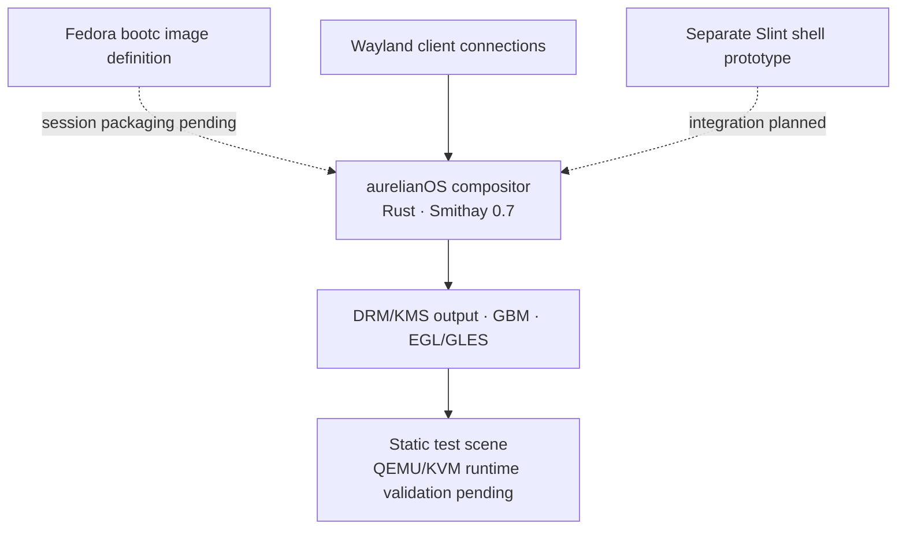
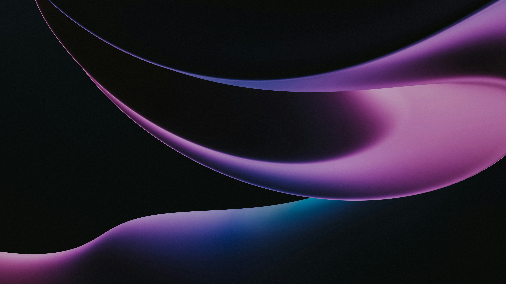

<p align="center">
  
</p>

<h1 align="center">aurelianOS</h1>

<p align="center"><strong>Linux, rebuilt around the desktop.</strong></p>

<p align="center">
  An experimental Linux desktop operating system for x86_64 PCs.<br>
  Its custom Wayland compositor and purpose-built shell are being developed as parts of one cohesive desktop experience.
</p>

<p align="center">
  <a href="#overview">Overview</a> ·
  <a href="#why-aurelianos">Why aurelianOS</a> ·
  <a href="#architecture">Architecture</a> ·
  <a href="#development-status">Status</a> ·
  <a href="#desktop-vision">Vision</a> ·
  <a href="#roadmap">Roadmap</a> ·
  <a href="#development">Development</a> ·
  <a href="#contributing">Contributing</a>
</p>

---

## Overview

> [!IMPORTANT]
> **aurelianOS is experimental.** Major desktop components remain incomplete, and development builds are not intended as a production daily-driver OS. Interfaces and architecture may change as the system is built.

aurelianOS aims to make ordinary desktop work and system administration graphical, while keeping the terminal and the underlying Linux system available to advanced users. The project is building its own Wayland compositor and desktop shell rather than assembling an existing desktop environment with a new theme.

The current repository contains a Fedora bootc image definition, a Rust/Smithay compositor, and a separate Rust/Slint shell prototype. Atomic image-based updates, Flatpak as the primary application delivery path, gaming, and easier Windows software compatibility are **design goals**; they are not finished desktop features.

## Why aurelianOS

| **Desktop first** | **Atomic and recoverable** | **Native Wayland** |
| :--- | :--- | :--- |
| **Goal** · Graphical settings and everyday administration without requiring a terminal. | **Direction** · Fedora bootc is the current image foundation; an update and rollback experience remains to be built. | **In code** · A custom Rust compositor uses Smithay 0.7 and serves Wayland clients. |
| **Gaming** | **Windows compatibility** | **Linux underneath** |
| **Goal** · Make gaming a first-class desktop design consideration. | **Long-term goal** · Integrate Wine/Proton workflows for Windows applications and games. | **Principle** · Preserve Linux tools, services, filesystems, and terminal access for people who want them. |

## Architecture

The components exist at different stages. The compositor and shell are currently independent projects; the bootc image definition does not yet package and start them as a complete desktop session.



Wayland client dispatch, DRM device discovery, output setup, GLES rendering, and page-flip handling are present in compositor code. Wayland surfaces are not yet drawn into that scene. The Slint prototype does not run as the compositor's integrated shell.

### Technology by layer

| Layer | Current choice | State |
| :--- | :--- | :--- |
| Base image | Fedora bootc | Image definition and QCOW2 manifest in the repository |
| Compositor | Rust + Smithay 0.7 | Implemented in code; early |
| Client protocol | Wayland | Server, socket, and client dispatch implemented |
| Display and graphics | udev/libseat, DRM/KMS, GBM, EGL/GLES | Code and Linux build verified; VM rendering pending |
| Desktop shell | Rust + Slint 1.14 | Standalone visual prototype |
| Application delivery | Flatpak | Architectural direction; integration planned |
| Windows software | Wine/Proton | Long-term integration goal |

## Development status

**How to read this:** *Implemented in code* describes what is present in the repository. *Compile-verified* means the compositor passed Linux `cargo check` and `cargo build`. *Runtime-verified* requires evidence from the actual aurelianOS QEMU/KVM display path; compilation alone does not establish that.

| Area | Current state | Boundary |
| :--- | :--- | :--- |
| Fedora bootc foundation | **Image definition present** | `bootc/Containerfile` and a QCOW2 conversion manifest exist; the desktop session is not packaged into the image. |
| Wayland server and socket | **Implemented in code** | The previous README reported a successful `wayland-info` connection; no session log is checked in. |
| Wayland client dispatch | **Implemented in code** | Client requests are dispatched through the compositor event loop. |
| DRM/KMS device and output setup | **Compile-verified** | Seat, device, connector, mode, and Wayland output code exists; QEMU/KVM runtime validation is pending. |
| GBM/EGL/GLES test rendering | **Compile-verified** | A static test scene is rendered and queued in code; its appearance on the VM display is unverified. |
| Page-flip events | **Implemented in code; runtime pending** | The DRM event handler calls `frame_submitted` after the matching event. |
| Desktop shell | **Standalone prototype** | Fullscreen wallpaper, floating dock, launcher mockup, status controls, Inter, and SVG icons. |
| Wayland surface rendering | **Planned** | Surface commits are observed, but client surfaces are not composited. |
| xdg-shell, window management, input, and focus | **Planned** | No complete desktop window or input policy is present. |
| Shell integration and compositor backdrop blur | **Planned** | The prototype's translucent UI is not compositor-level blur. |
| Full desktop experience | **Long-term goal** | Settings, applications, updates, recovery, and hardware workflows remain to be built. |

### The current compositor milestone

The immediate task is to validate this path on the aurelianOS QEMU/KVM display:

```text
Wayland server → DRM/KMS device + output → GBM → EGL/GLES
               → static test frame → KMS submission → page-flip event
```

The code implements this sequence and compiles on Linux; the VM must still show the frame and emit the expected output and page-flip logs. The test scene is deliberately static and does not represent a finished desktop.

## Desktop vision

The standalone Slint shell explores a wallpaper-forward layout with a floating dock, launcher panel, restrained translucent surfaces, rounded controls, Inter typography, and vector icons. Its launcher entries and status readouts are prototype UI, not functional system integrations.

The intended desktop extends that language with cohesive graphical settings, subtle motion, scalable layouts, HiDPI and multi-monitor support. Real backdrop blur and other glass effects are intended to be rendered by the compositor with attention to GPU cost and damage tracking. Those effects are still planned.



<p align="center"><sub>Bundled prototype wallpaper · visual asset, not a screenshot of an integrated desktop session</sub></p>

## Repository map

```text
aurelianOS/
├── assets/
│   ├── branding/          canonical logo and wordmark
│   ├── fonts/             bundled Inter fonts
│   ├── icons/             SVG shell icons
│   └── wallpaper.jpg
├── bootc/
│   ├── Containerfile      Fedora bootc image definition
│   ├── compositor/        Rust + Smithay compositor
│   ├── shell/             separate Rust + Slint prototype
│   └── output/            osbuild QCOW2 manifest
├── docs/decisions/        architecture decisions
├── buildroot/             earlier system experiment
└── scripts/build.sh       earlier Buildroot build path
```

The `compatibility/`, `desktop/`, `installer/`, `system/`, and `tests/` directories are currently placeholders. Buildroot remains in the repository for earlier work; the current system direction is under `bootc/`.

## Development

The developer workflow is still evolving. The [bootc image definition](bootc/Containerfile) sets up a Fedora bootc base and development login, but it does not yet install or launch the compositor or shell. The checked-in QCOW2 manifest records an image conversion pipeline; it is not a QEMU launch script. [`scripts/build.sh`](scripts/build.sh) targets the earlier Buildroot tree.

The compositor is a separate Cargo project. On Linux with its native graphics and session dependencies installed, the following commands have passed for the current code:

```bash
cd bootc/compositor
cargo check --locked
cargo build --locked
```

The [Slint shell](bootc/shell) is also a separate Cargo project. There is not yet a documented one-command build that produces an integrated aurelianOS desktop image. See the [desktop](docs/decisions/0001-desktop-arch.md), [compositor](docs/decisions/0002-compositor.md), [UI toolkit](docs/decisions/0003-ui-toolkit.md), and [bootc foundation](docs/decisions/0006-longterm-os-foundation.md) decisions for architectural context.

## Roadmap

**Next in the compositor**

1. Validate the DRM/KMS → GLES → page-flip path in the aurelianOS QEMU/KVM environment.
2. Render Wayland client surfaces on the detected output.
3. Add xdg-shell and basic window management.
4. Establish keyboard, pointer, and focus behavior.
5. Integrate the Slint shell into the desktop session.
6. Develop compositor-driven visual effects once scene rendering is sound.

**Beyond the first desktop session**

| System experience | Desktop and compatibility |
| :--- | :--- |
| Graphical administration, settings, hardware controls, installation, and onboarding | Notifications, application management, Flatpak integration, and a cohesive first-party interface |
| Atomic update and rollback UX, recovery, and image distribution | Gaming workflows, future Wine/Proton integration, and broader application compatibility |
| Wider hardware validation and maintenance | Multi-monitor behavior, HiDPI refinement, accessibility, and internationalization |

These are directions, not release commitments. No release date or compatibility guarantee is implied.

## Contributing

The project is early and primarily developed by one person. Focused bug reports, QEMU/KVM validation, design discussion, documentation, and narrowly scoped code contributions are welcome. For larger changes, discuss the approach before implementation. See [CONTRIBUTING.md](CONTRIBUTING.md) for the current contribution guidance.

## Support

Donations can help with development hardware, testing, and hosting. Check the asset and network carefully before sending. The BNB Smart Chain and USDT (BEP-20) entries use the same address in the original README.

<details>
<summary><strong>Cryptocurrency donation addresses</strong></summary>

| Cryptocurrency / network | Address |
| :--- | :--- |
| Bitcoin | `bc1q8l5tcp6rx6q06qj323dqt4q3ywsh7x6wus2jjn` |
| Litecoin | `ltc1qg3rmw5zh4k47wqm30utsv7hqaqalsk3e5uhaw7` |
| BNB Smart Chain | `0x2321cBfFA5CaA335F10C71Eb078D61E662E201Be` |
| USDT (BEP-20) | `0x2321cBfFA5CaA335F10C71Eb078D61E662E201Be` |
| USDC (Solana) | `F9fdD2r9PatQds68wHjfSCachHndt91wefrxD5WPFkJs` |

</details>

## Licensing and branding

Original aurelianOS source code is under the [Apache License 2.0](LICENSE) unless otherwise specified. Third-party software, fonts, icons, artwork, and other materials retain their own licenses and attribution; see [NOTICE](NOTICE).

The name, logo, and official branding are addressed separately in [TRADEMARKS.md](TRADEMARKS.md). Forks and modified distributions are permitted under the software license, but should not present themselves as official aurelianOS releases or imply project endorsement.

<p align="center">
  
</p>

> **README note**
>
> This README was written and polished with assistance from a large language model (LLM). The aurelianOS project, its architecture, implementation, design decisions, and development are human-directed.
